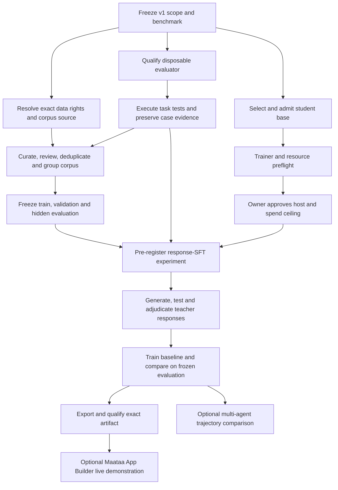

# Guru-Code: detailed atomic execution plan

**Plan status:** proposed execution sequence, refreshed 2026-10-12

**Product outcome:** a qualified, local Guru-Code checkpoint for one operator and one approved project. Initial capability scope is Python code with Brahmi comments and explanations; Python syntax remains conventional. This plan does not claim the checkpoint exists.

## 1. Current baseline

| Area | State | Consequence |
| --- | --- | --- |
| Teacher intake | One Qwen2.5-Coder-7B-Instruct digest is approved for `may_train` output rights in `data/coding/teacher-registry.jsonl`. | Approval is limited to that teacher record. It does not approve any dataset or change runtime-model qualification. |
| Candidate data | TinyPython is quarantined. Checked-in task files are small synthetic fixtures. | No real training corpus is admitted. |
| Evaluator | Container prequalification exists; full disposable-worker qualification and generated-code test execution do not. | `tests_pass` and executable correctness are not measurable; corpus admission and the experiment remain blocked. |
| Student base and recipe | No admitted student base or complete SFT/LoRA path is selected. | Do not start training. |
| Compute | No approved training host or budget. | GPU spend and paid training are not authorized. |
| Maataa runtime | No current exact-digest coding qualification is recorded for Qwen in the active Maataa database. | App Builder mock/browser success is not real-model qualification or a live coding demonstration. |
| Release | No Guru-Code checkpoint exists. | Guru-Code is not release-ready. |

### Implementation evidence updated 2026-10-12

| Work slice | Current implementation evidence | What remains open |
| --- | --- | --- |
| B0.1–B0.4 evaluator evidence contract | Commits `5f24668` (integrated from isolated agent branch); strict case schema, digest chain, durable atomic append/replay and fail-closed `TESTS` mapper. Focused evaluator suites: 22 passed. | No actual task runner/backend, disposable host, candidate-code execution, independent review or evaluator lock. This does not make executable correctness measurable. |
| I2/I3 item-bound admission integrity | Commits `d1bd36d` and `6981a0f`; canonical digest covers every serialized `CorpusItem` field, quality decisions carry the digest, assembly recomputes it, and duplicate item decisions block preflight/assembly. Quality + corpus suites: 27 passed. | Other audit-record schema/integrity checks, item/source rights-scope validation, complete source-manifest verification, orchestration and group-aware splits remain open. |
| I4 teacher-lineage binding | Integrated as `244d6f3`; admitted `c_rd`/`c_trace` items require a unique, admissible registry teacher reference; declared refs are checked for all corpus kinds. Focused corpus suite: 18 passed. | Source-level rights still need review; registry teacher admission does not approve individual item data or rights. C_TRACE currently assumes teacher-derived examples. |
| I5 deterministic check producers | Integrated as `7177e61` from isolated commit `7fc0ea7`; pure schema, Python syntax, security diagnostic, source-digest membership, exact-duplicate and leakage check producers. Focused suite rerun after integration: 13 passed. | No orchestration; source rights/license evidence, teacher-registry check, frozen-snapshot verification and executable test evidence remain open. These producers do not decide rights or evaluate generated code. |
| Maataa Coding Studio/App Builder | Commit `d94fec5` shortens the App Builder default-folder button label while preserving the full path in its title. Focused 390 px case passed; Playwright Coding Studio/App Builder specs: 13 passed. Full Maataa `npm test`: 768 passed, 0 failed, 1 skipped. | Playwright uses simulated model responses; it does not qualify a Guru checkpoint. |
| Integrated CPU apparatus suite | Documented apparatus command includes evaluator evidence, deterministic quality checks and I4 lineage binding: 109 passed on the available Python 3.12 environment after integration. | Full `pytest tests/` was attempted and returned 147 passed, 1 skipped, 3 failed because SentencePiece is absent; these failures are outside the documented lightweight apparatus suite. Run a full training-dependency environment before treating all repository tests as verified. |

The source roadmap remains [CODING_STUDIO_ROADMAP.md](../CODING_STUDIO_ROADMAP.md), and rights/evaluator context is in [CODING_PHASE5_EXECUTION_PACKET.md](CODING_PHASE5_EXECUTION_PACKET.md). This file decomposes those gates into reviewable work units.
The v1 benchmark proposal is in [benchmark-contract-v0.1.md](experiments/exp-rd-vs-sft-001/benchmark-contract-v0.1.md); it remains draft-only until owner ratification.

### Newly verified implementation gaps

The latest source audit confirms additional code-level work that must precede
real admission. These are separate from external rights and host decisions.
The I5 deterministic producer subset is now integrated, but the integrated
production path remains incomplete:

- `guru/quality/gate.py` consumes eight caller-supplied `AutoCheckResult`
  values, but production code has no complete producer/orchestration path. Unit
  tests construct checks directly. `guru/quality/checks.py` covers deterministic
  subsets only; the gate itself is not evidence that checks ran.
- Corpus preflight checks the presence of task IDs, an admissible teacher and
  an admitted audit row; it now rejects duplicate item decisions. The quality
  decision also carries a canonical item digest, which assembly recomputes and
  compares before admitting an item. Assembly still does not verify every
  item's teacher against the admitted registry or fully validate source rights.
- Corpus rows do not yet require a typed task/source provenance record or
  leakage group. The existing deterministic split is task-level and cannot by
  itself prevent repository, source, family, duplicate or trajectory leakage.
- The Qwen teacher record is not approval for TinyPython, synthetic fixtures,
  generated items, or training inputs. No empty audit file or test-generated
  decision may be treated as real admission evidence.

These findings add the local engineering lane I below. It may be implemented
against synthetic fixtures, but those fixtures must remain explicitly marked
synthetic and can never make the real-corpus preflight ready.

## 2. Work-unit contract

Every work unit below has one primary output and one observable exit check. A unit may be marked complete only when the output and check are saved with the relevant commit, report, manifest, or review record. A checkbox is a tracker, not evidence by itself.

**Roles**

- **Owner/reviewer:** makes rights, runtime-use, model-base and spending decisions; provides a name and date where the record requires it.
- **Engineering:** implements schemas, tools, runner, trainer and integrations; records exact versions and hashes.
- **Independent reviewer:** inspects evaluator isolation, rights evidence or benchmark results without relying solely on the implementer's summary.

No external teacher transmission, corpus admission, paid compute, weight release, or final capability claim is implied by this plan.

## 3. Dependency map

Rights review and evaluator implementation can proceed in parallel. Corpus freezing waits for both. Student-base research can proceed in parallel, but training waits for corpus, evaluator, trainer preflight, and owner-approved compute.

### Multi-agent execution boundaries

When implementation begins, each coding agent gets its own Git worktree and
branch based on the same recorded integration commit. Do not let agents edit a
shared checkout. Each handoff includes changed paths, commit SHA, focused test
output, `git diff --check`, known limitations, and any gate it deliberately
does not close. The integrator reviews and cherry-picks in dependency order;
conflicts or contract changes return to the owning lane before integration.

| Track | Agent-sized assignment | Exclusive path boundary | May proceed alongside | Must wait for |
| --- | --- | --- | --- | --- |
| M1 | Evaluator evidence contract B0.1–B0.4 | New evaluator evidence schema/store/protocol modules and their focused tests only. | M2, M3, owner rights review. | A1/A3 contract shape; must label backend as unavailable. |
| M2 | Corpus/quality integrity I1–I4, I7 | New typed provenance schemas and audit/assembly validation modules/tests; no evaluator runner edits. | M1, M3. | Shared item-digest and rights-policy decisions from A/C; coordinate schema interfaces before coding. |
| M3 | Deterministic checks I5 and orchestration design for I8 | Integrated partial producer slice in `7177e61` (`checks.py` and focused tests); no `quality/gate.py` policy changes without explicit scoped review. | M1/M2. | I1/I2 schema contracts; evaluator-dependent checks stay unavailable. |
| M4 | Independent evaluator threat-model review and host decision packet | Read-only review notes and host decision template; no runner implementation or host provisioning. | M1–M3. | Owner must supply/approve a real disposable host before any candidate execution. |
| Integrator | Interfaces, full-suite integration, C9 and release evidence | Existing shared integration worktree only after lane commits are reviewed. | None during concurrent file edits. | Required lanes and external approvals in the dependency map. |

M1–M3 are suitable first isolated coding tracks. They must agree on schemas
before merging: B0 evidence status and digests feed `I5/I6`, item digests feed
audit binding, and the quality runner consumes both. M4 cannot convert a
documented design into evaluator qualification. None of these agents may
approve rights, spend compute or mark real examples admitted.

## 4. Atomic work units

### Lane A — scope and benchmark contract

| ID | Atomic task | Output | Exit check / dependency |
| --- | --- | --- | --- |
| A1 | Write the v1 scope: Python only, one operator, one approved project, supported task types, max project/context size, and Brahmi comment/explanation policy. | Versioned benchmark-scope record. | Owner and engineering sign the same scope; no additional language is included by implication. |
| A2 | Define benchmark strata and minimum examples for task families (bug fix, feature, refactor, explanation, tests, multi-file project). | Task-mix table and sampling rules. | Every stratum has a count target, inclusion rule and excluded-task rule. |
| A3 | Define correctness/security pass bars, run budget, time/resource limits, and stop rules before seeing hidden results. | Benchmark acceptance policy. | Numeric thresholds and review procedure are frozen and versioned. |
| A4 | Pin the reference environment for the first benchmark. | Toolchain manifest for Python, OS/container base, test runner and dependency policy. | Versions and image/build digests resolve reproducibly; no floating tags. |

### Lane B — disposable evaluator qualification

The evaluator has two work tracks. B0 is safe local contract/plumbing work and
can proceed before a disposable host is approved. B1–B8 require the real host
for execution and qualification. B0 does not qualify a backend or make
`tests_pass` measurable.

| ID | Atomic task | Output | Exit check / dependency |
| --- | --- | --- | --- |
| B0.1 | Define a versioned case-evidence schema binding run/case/task IDs, candidate and test digests, runner image/config digest, fixed command, limits, timestamps, terminal status and bounded output digests. | Strict case-evidence schema. | Reject missing/unknown status, malformed digest, impossible timestamps, unbounded fields and a pass without exit/test evidence. |
| B0.2 | Implement canonical evidence serialization, durable atomic write, integrity verification and replay. | Evidence-store helper and format note. | Inject truncation, duplicate case IDs, hash mismatch and interrupted writes; all fail closed. No raw credentials or unrestricted output persisted. |
| B0.3 | Define an evaluator protocol and `tests_pass` result mapper that can represent unavailable, infrastructure failure, timeout and completed test outcomes distinctly. | Backend-neutral evaluator interface and check mapper. | Fake backend demonstrates pass/fail mapping; unavailable and malformed evidence never map to pass. |
| B0.4 | Add unit tests for B0.1–B0.3 using synthetic payloads only. | Focused evaluator contract suite. | Tests prove schema, persistence, replay and fail-closed mappings; report states that no candidate code was executed. |

| ID | Atomic task | Output | Exit check / dependency |
| --- | --- | --- | --- |
| B1 | Select a disposable Linux host/runtime and document who controls it and how it is reset. | Host decision record and isolation diagram. | Owner approves the host; disposable lifecycle and operator access are explicit. No candidate code is run yet. |
| B2 | Implement the evaluator worker boundary: no host/project/credential mounts, no egress, read-only base, unprivileged identity, capped CPU/memory/PIDs/disk, wall timeout and bounded output. | Versioned evaluator image and launch configuration. | Automated inspection confirms the declared controls on the actual worker. |
| B3 | Implement startup cleanup and reaping for abandoned workers, including daemon restart and host restart. | Recovery/reaper implementation. | Injected crash/restart leaves no surviving worker or stale case marked successful. |
| B4 | Add per-case execution records with input digest, candidate digest, image digest, command, limits, exit status, timeout/cancel status, captured output digest and timestamps. | Durable evaluator case record schema and storage. | Replaying a saved record verifies its hashes; raw secrets are absent. |
| B5 | Add evaluator acceptance fixtures for allowed execution, compile/test failure, timeout, resource exhaustion, cancellation, worker crash, restart, attempted egress, attempted host access and malformed output. | Adversarial evaluator suite. | Each expected denial/cleanup outcome is asserted; every case has durable evidence. |
| B6 | Connect `tests_pass` and `executable_correctness` to actual isolated task-test results. | Evaluator adapter and quality-check result producer. | On the approved worker, a deliberately passing and failing generated proposal produce opposite, traceable results; missing results fail closed. |
| B7 | Have an independent reviewer inspect host isolation, evidence integrity, recovery and residual risks. | Signed qualification report with image/config digests. | All required probes pass or have an explicitly accepted, bounded exception; no unsupported security claim. |
| B8 | Freeze the evaluator image and acceptance policy for the experiment. | Evaluator lock record. | Any change to image, runtime or policy invalidates the qualification until rechecked. |

**Gate B:** Until B1–B8 pass, do not execute candidate/generated code for corpus admission, claim `tests_pass`, start `exp-rd-vs-sft-001`, or claim coding capability.

### Lane C — data rights and corpus

| ID | Atomic task | Output | Exit check / dependency |
| --- | --- | --- | --- |
| C1 | Review the pinned TinyPython artifact, card revision, file listing, hash, dataset terms and teacher lineage. | Completed rights-review decision for the exact artifact. | Named reviewer answers training, evaluation, transformation/retention and weight-distribution rights separately. Unknown answers remain “not approved.” |
| C2 | If C1 is declined or unresolved, choose an alternative source: original task authoring, another reviewed corpus, or a combination. | Source selection record. | Each source has pinned bytes/revision, license evidence, permitted uses and removal/notice obligations. |
| C3 | Define transmission policy for every source and teacher. | Disclosure decision matrix. | Local-only vs external inference, allowed input classes, provider retention/training, confidentiality and residency are explicit. |
| C4 | Add or verify per-item lineage, source digest, task family, origin/author, teacher digest, license, permitted uses, leakage group, split and review state. | Validated corpus manifest entries. | Schema validation rejects missing or contradictory required provenance. |
| C5 | Build the v1 corpus from approved material only. Keep synthetic fixtures, retrieval-only material, evaluation-only material and quarantined rows separate. | Versioned corpus candidate plus source manifest. | Every included row traces to an approved source and use; quarantined rows cannot enter export. |
| C6 | Deduplicate exact and near-duplicate prompts/code; group by repository, source, task family, generator/trajectory and derivative lineage. | Deduplication report and group IDs. | Reviewable counts explain removed/retained rows; duplicates and related variants cannot cross splits. |
| C7 | Review quality and acceptance criteria. Label incorrect, ambiguous, incomplete, insecure and unsupported answers; retain failures only with explicit non-gold labels. | Per-item review decisions and batch summary. | Human sampling/conflict rules from A3 are met; rejected items cannot be exported as targets. |
| C8 | Create deterministic train/validation/hidden-evaluation partitions by leakage group. | Frozen split manifest with hashes. | No group crosses partitions; hidden targets are access-controlled and were not used for prompt/model selection. |
| C9 | Run corpus preflight and produce the real admission audit from actual decisions. | `c_rd` preflight output and admission audit. | Preflight is ready without fabricated/empty audit files; every admitted item has required checks and owner/reviewer evidence. |

**Gate C:** A teacher registry entry is not dataset approval. C1–C9 are required before candidate-corpus assembly or training.

### Lane I — quality-check production and corpus integrity

This lane closes the gap between the quality-gate policy and real check
evidence. Its deterministic checks can be developed on synthetic test data;
check producers must record “unmeasured/unavailable” where authority or an
external tool is missing. Do not invent a passing `LICENSE_CLEAR`,
`TESTS_PASS`, `TEACHER_ADMITTED` or `SNAPSHOT_PINNED` result.

| ID | Atomic task | Output | Exit check / dependency |
| --- | --- | --- | --- |
| I1 | Define typed task, source-manifest and item-lineage schemas, including exact artifact digest, rights scope, source class, leakage group, teacher ref and review state. | Versioned provenance schemas. | Invalid/missing provenance and unknown rights states are rejected; migrations have explicit versions. |
| I2 | Define canonical item-content digest over all admission-relevant fields and include it in check and decision evidence. | Digest contract and schema update. | Any prompt/target/source/teacher/test change changes the digest; serializer is stable across supported Python runs. |
| I3 | Harden admission-audit loading: reject duplicate/conflicting item decisions, malformed records, digest mismatch and records missing required checks. | Audit loader and integrity tests. | Conflicting duplicate rows never use last-write-wins; malformed or incomplete audit makes preflight fail closed. |
| I4 | Bind each admitted item to exact content and validate every referenced teacher against the approved registry and matching rights scope. | Admission-to-item/teacher verifier. | Changed item bytes or unapproved/mismatched teacher blocks; approved teacher alone does not imply item/source approval. |
| I5 | Implement deterministic non-execution check producers: schema, syntax, CoT markers, secret scan, pinned snapshot/provenance, and duplicate/leakage checks. | Check orchestration for available deterministic checks. | Each result includes evidence digest/tool version; scanner error, missing input or unknown provenance is failure/unmeasured, never pass. |
| I6 | Integrate the qualified evaluator result from B6 as the sole source of `TESTS_PASS` and executable correctness. | End-to-end check producer. | This unit cannot be marked complete before B1–B8; evaluator unavailable produces a blocking result. |
| I7 | Define license check semantics across source/license, teacher output rights, task use, transformation/retention and intended weight distribution. | Versioned license policy and decision fields. | Intake `license` alone cannot pass item rights; rights reviewer decision must bind source and use scope. |
| I8 | Build the item/batch quality runner that invokes producers, calls existing decision functions, records evidence and writes audit only for complete evaluated batches. | Quality orchestration CLI/API. | Missing any required check prevents admission and audit write; partial failures are preserved as rejected evidence without passing rows. |
| I9 | Add group-aware split assignment and leakage assertions across repository/source/family/duplicate/trajectory groups. | Deterministic split implementation and manifest. | Same leakage group cannot cross train/validation/test; exact counts and seed/algorithm are recorded. |
| I10 | Verify corpus assembly against immutable audit and source manifests. | Hardened preflight/assembler integration. | Every emitted row matches its admitted content digest, teacher/source rights and frozen split; no synthetic fixture can satisfy real-corpus readiness. |
| I11 | Run clean synthetic integration tests and independent review of fail-closed behavior. | Test report and review record. | All negative/attack fixtures block admission; no test writes to the real registry, corpus, or audit location. |

**Gate I:** Unit tests that manufacture `AutoCheckResult` objects do not close
this lane. Real admission requires the production orchestration, item-bound
evidence, rights-scoped decisions, and B-qualified executable tests.

### Lane D — student base, trainer and compute

| ID | Atomic task | Output | Exit check / dependency |
| --- | --- | --- | --- |
| D1 | Compare candidate student bases separately from teacher models: architecture, digest, tokenizer, context, quantization, access and terms. | Shortlist and exact model-intake records. | Each candidate has primary-source license/terms evidence and at least 4,096-token context; unsupported facts stay unknown. |
| D2 | Owner selects the student base and allowed adapter/fine-tuning method. | Named decision in model intake/decision log. | Owner, date, digest and permitted derivative/weight use are recorded. |
| D3 | Specify a reproducible SFT recipe: data order/sampling, sequence length, optimizer, precision, seed, checkpoints, evaluation hooks and stop rules. | Versioned training configuration. | Configuration is deterministic where feasible and all dependencies are locked. |
| D4 | Implement the chosen LoRA/QLoRA or full-fine-tuning path for the selected architecture. | Trainer implementation. | Tiny synthetic smoke verifies save/resume and loss path; it is labeled smoke-only. |
| D5 | Run local resource and restart preflight. | Memory/throughput/checkpoint recovery report. | Peak memory and restart behavior are measured on target-like sequences; no projected cost is presented as observed throughput. |
| D6 | Estimate compute cost from measured throughput and total planned tokens/steps; record provider, region, machine and price timestamp. | Cost worksheet with low/high range. | Assumptions and current quotes are reproducible; price is rechecked before launch. |
| D7 | Obtain explicit owner approval for provider/account and maximum spend. | Signed budget decision. | Ceiling, account owner, machine limits and shutdown procedure are filled. No approval means no paid job. |
| D8 | Run the approved benchmark-only GPU pilot. | Raw benchmark logs and host/GPU/commit metadata. | Runtime, memory and shutdown are verified; result informs the final run plan. |

**Gate D:** D1–D6 can be researched/implemented without renting a GPU. D7 is mandatory before D8 or any paid training.

### Lane E — experiment registration and teacher responses

| ID | Atomic task | Output | Exit check / dependency |
| --- | --- | --- | --- |
| E1 | Complete the `exp-rd-vs-sft-001` registration with scope, corpus hash, evaluator image, student/base digest, baseline, seeds, strata, thresholds, sample count and stop rules. | Frozen, timestamped pre-registration. | A3, B8, C8 and D2–D6 are complete; hidden evaluation targets remain unopened. |
| E2 | Generate teacher responses only for approved training tasks under the approved disclosure policy. | Raw teacher-response records with request/output hashes and lineage. | Teacher digest matches registry; no unapproved task is transmitted; prompts and generation configuration are reconstructable. |
| E3 | Run generated responses through automated structure, safety, license, tests and evaluator checks. | Per-response check records. | All required checks exist and are produced from actual artifacts; missing checks reject the item. |
| E4 | Human-review required tiers, adjudicate conflicts and record rejection reasons. | Reviewed admission decisions. | Sampling and acceptance thresholds in A3 are met; no unreviewed “gold” targets. |
| E5 | Apply the sequential batch-admission rule and write the real admission audit. | Immutable audit batch. | Audit count/digests match the reviewed items; corpus preflight remains green after reload. |

### Lane F — response-SFT baseline and evaluation

| ID | Atomic task | Output | Exit check / dependency |
| --- | --- | --- | --- |
| F1 | Train the baseline student using the frozen training split and approved recipe. | Checkpoint, trainer logs and run manifest. | Base, tokenizer, corpus, recipe, code commit and seed digests are recorded; checkpoint resumes successfully. |
| F2 | Evaluate on validation only and apply pre-registered stop rules. | Validation report. | No hidden evaluation target was used for tuning; thresholds and deviations are reported. |
| F3 | Run the frozen hidden evaluation once under the qualified evaluator. | Per-case results and aggregate report by task stratum. | Case evidence references the frozen evaluator and checkpoint digests; report includes failures and uncertainty, not only aggregate pass rate. |
| F4 | Compare against the declared baseline using pre-registered metrics and regression rules. | Decision report: advance, revise under a new registration, or stop. | Decision follows the registered rules; no post-hoc threshold changes. |
| F5 | Preserve artifacts, costs and data/rights lineage. | Reproducibility bundle. | Independent reviewer can verify hashes and rerun permitted parts without hidden credentials. |

### Lane G — exact artifact qualification and Maataa integration

| ID | Atomic task | Output | Exit check / dependency |
| --- | --- | --- | --- |
| G1 | Export the selected checkpoint with tokenizer and runtime metadata. | Export bundle and SHA-256 manifest. | Reloading the exact files reproduces the checkpoint identity and required context; no undocumented conversion. |
| G2 | Complete license, attribution, notices, dataset obligations and weight-distribution review. | Release rights checklist and notices. | Every base/data/teacher source is covered for the intended distribution; unresolved terms block release. |
| G3 | Install the exact artifact in the target local runtime and verify model digest/context. | Runtime verification record. | Runtime reports the expected digest and at least 4,096-token context; no tag-only identity. |
| G4 | Run Maataa’s six coding/control capabilities for three clean trials each on the exact digest. | Qualification result with 18 trial records. | Required capabilities pass with zero failed trials; no mocked qualification data. |
| G5 | Exercise App Builder on a disposable approved project with this exact qualified model. | Build/run evidence: prompt, digest, proposal, tests, reviewed batch and final project result. | Only use approved root; all tests execute; human reviews/approves writes; cleanup or retain project per explicit choice. |
| G6 | Conduct release review and publish/retain according to approved distribution decision. | Release manifest and signed go/no-go. | B, C, D, E, F and G1–G5 pass; otherwise record “not release-ready” and blockers. |

### Lane H — optional multi-agent trajectory comparison

This lane follows the response-SFT baseline; it is not a prerequisite for the first checkpoint.

| ID | Atomic task | Output | Exit check / dependency |
| --- | --- | --- | --- |
| H1 | Connect the trajectory schema to real Planner → Coder → Tester → Reviewer → Supervisor records. | Trace exporter with role/model and action lineage. | Trace validator resolves every referenced task, patch, test and decision; human adjudication remains separately identified. |
| H2 | Obtain rights/transmission approval and filter the trace pool. | Trace-source decision and approved trace manifest. | No trace enters training solely because agents agree; privacy, rights, leakage and correctness checks pass. |
| H3 | Compare trajectory training with response-SFT using the same student and frozen evaluator. | Separate pre-registration and comparison report. | Identical held-out suite and predeclared metrics; no chain-of-thought requirement. |

## 5. Owner decisions that must stay open until answered

| Decision | Current record | Required action |
| --- | --- | --- |
| Runtime model D1 | Unchecked; no exact Qwen runtime qualification in the active Maataa DB. | Decide whether to use Qwen as runtime model; independently qualify the exact installed digest before coding use. |
| TinyPython D2 | All use boxes unchecked; shard remains quarantined. | Answer training, evaluation, transformed-copy retention and weight-distribution questions individually, or select another corpus. |
| Student base D3 | Unchecked. | Select a named exact base and method after terms/context/memory review. |
| GPU ceiling D4 | Unchecked; no account/host approved. | Set provider, account owner, ceiling and shutdown policy before paid compute. |

Engineering must not fill these fields by inference. A “no” or “not now” is a valid outcome and keeps dependent work blocked.

## 6. Immediate ordered queue

The queue distinguishes work that is safe to execute now from gates that need
owner action or external infrastructure. “Parallel” does not mean one gate can
be used as evidence for another.

1. **Complete I5 and contract work:** add mutation-stable evidence/version
   attribution where required, pin valid split labels and authoritative
   manifest semantics, then review the deterministic-check API against I1/I2.
   Keep this as the partial I5 implementation until its full exit criteria pass.
2. **A1–A3 + B0.1–B0.4 + I1–I4 + I7:** finish the remaining contracts and
   integrity checks using clearly synthetic fixtures. Keep the evaluator
   result unavailable and do not write real admission records.
3. **Owner decisions in parallel:** ratify A1–A3 scope/threshold proposals;
   decide B1 host/reset lifecycle; decide C1 exact candidate-data rights and
   C2 fallback; decide C3 teacher disclosure; decide D1/D2 student base/method.
   No network teacher request or paid compute is implied.
4. **B1–B8:** after host approval, build, attack-test, independently review and
   freeze the disposable evaluator. B0 work is not a substitute.
5. **I5 completion, I6 + I8–I11:** complete remaining deterministic checks,
   then only after evaluator qualification connect genuine test
   results, produce all eight required checks, bind them to exact item bytes,
   and verify the full audit-to-assembler path on synthetic negative/positive
   fixtures. Keep the real corpus blocked until C1–C3 close.
6. **C4–C9:** curate only approved sources, deduplicate and group leakage,
   human-review items, freeze splits and generate the real admission audit.
7. **D1–D6:** select/admit the student, finish the recipe, trainer and measured
   resource/restart preflight. Research cost only; do not rent resources.
8. **D7–D8:** after explicit host/account/ceiling approval, run the bounded
   benchmark-only pilot and verify automatic shutdown.
9. **E1–E5:** freeze the preregistration; generate, evaluate, human-review and
   admit teacher responses only under approved rights/disclosure.
10. **F1–F5:** train matched baseline/treatment runs, evaluate the frozen suite,
   preserve measured cost, and make the predeclared decision.
11. **G1–G6:** export, clear distribution rights, qualify the exact artifact,
    run the 18-trial Maataa exact-digest workflow and App Builder, then record
    owner go/no-go.
12. **H1–H3:** optional trajectory-distillation experiment, after first
    response-SFT baseline and separate trajectory-rights approval.

## 7. Atomic commit and evidence policy

- Keep plan/contract edits documentation-only and separate from code changes.
- For implementation, one commit should cover one cohesive ID or a tightly
  coupled pair (for example I2+I3); commit messages name the IDs and behavior.
- Before each commit, inspect staged paths, run the focused tests named by the
  unit, run `git diff --cached --check`, and capture exact output in that unit's
  evidence note. Run the full Guru suite at integration gates B8, I11, C9, F5
  and G4; run Playwright for Maataa integration G4–G5 against a fresh build.
- Never check in credentials, raw secrets, hidden evaluation targets or
  unreviewed teacher outputs. Keep external approval records explicit and
  attributable; a local test report cannot stand in for owner approval.
- Do not commit/push unfinished work as a release claim. Push only the final
  reviewed branch after the completion gates and current-tree evidence pass.

## 8. Completion rule

“Roadmap complete” means G6 has a reviewable go decision backed by exact data, evaluator, training, artifact and qualification evidence. Passing unit tests, a preflight report, a synthetic App Builder demo, an approved teacher record, or a CPU smoke run alone does not meet that bar.
