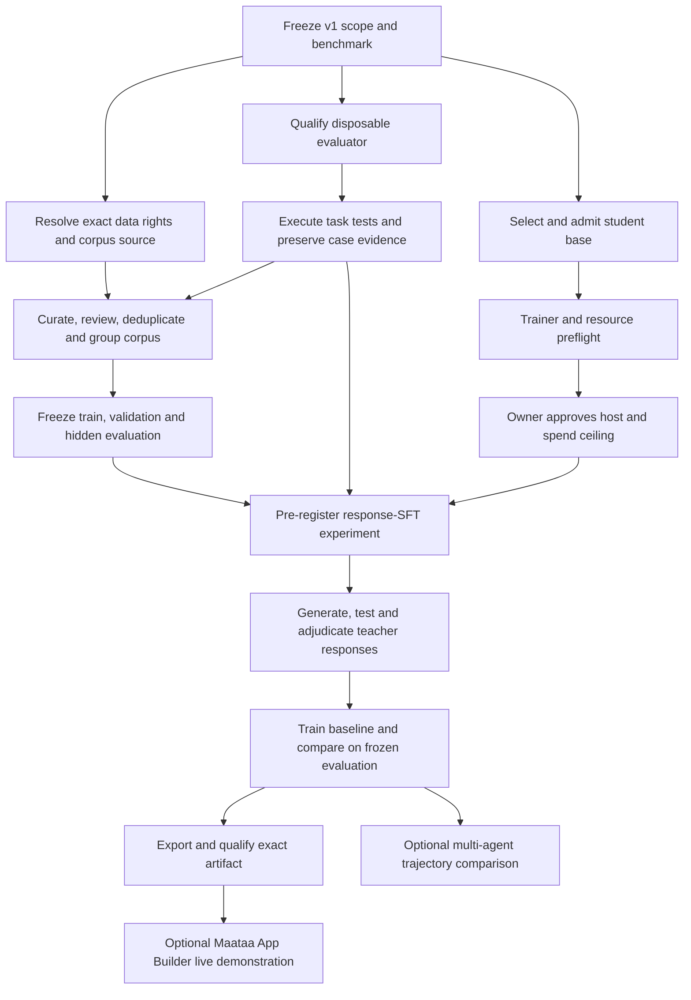

# Guru-Code: detailed atomic execution plan

**Plan status:** proposed execution sequence, refreshed 2026-10-13

**Product outcome:** a qualified, local Guru-Code checkpoint for one operator and one approved project. Initial capability scope is Python code with Brahmi comments and explanations; Python syntax remains conventional. This plan does not claim the checkpoint exists.

## 1. Current baseline

| Area | State | Consequence |
| --- | --- | --- |
| Teacher intake | One Qwen2.5-Coder-7B-Instruct digest is approved for `may_train` output rights in `data/coding/teacher-registry.jsonl`. | Approval is limited to that teacher record. It does not approve any dataset or change runtime-model qualification. |
| Candidate data | TinyPython is quarantined. Checked-in task files are small synthetic fixtures. | No real training corpus is admitted. |
| Evaluator | Container prequalification exists; full disposable-worker qualification and generated-code test execution do not. | `tests_pass` and executable correctness are not measurable; corpus admission and the experiment remain blocked. |
| Student base and recipe | **Candidate/method selected; model intake open.** The owner selected `Qwen/Qwen2.5-Coder-1.5B` (base, not Instruct) at revision `ccb64f03a691be46ba6b4e4c91f396c247aa66c7` with LoRA SFT. The D3 recipe remains a draft and non-launchable. | The selection authorizes no download or training. Exact weight/tokenizer digests, rights and model intake remain open. A new Qwen2-family LoRA mechanics scaffold checks the launch gate before model/optimizer/step/checkpoint access, but does not load or digest-bind selected artifacts; its generic methods reject the current draft recipe. The random tiny-Qwen2 resume smoke remains a separate synthetic plumbing test and does not qualify selected-checkpoint compatibility, recipe, memory fit or coding capability. The current custom `GuruForCausalLM` trainer cannot fine-tune this architecture. |
| Compute | Conditional training-resource decision: one Lambda H100 SXM pilot in `asia-south-1` if offered/available, maximum four hours and US$25 including tax; use an existing owner-controlled account only. Account availability has not been verified and no instance was launched. | This cap applies only to a later bounded resource preflight after rights, evaluator and trainer prerequisites pass. No training run or spend is authorized before those gates and account/region availability are confirmed. |
| Maataa runtime | Selected `qwen2.5:7b`, Ollama digest `845dbda0ea48ed749caafd9e6037047aa19acfcfd82e704d7ca97d631a0b697e`, has a fresh 18/18 Maataa coding-workflow qualification on 2026-10-12 (three trials each across six capabilities). | This qualifies the exact installed runtime for Maataa's six workflow checks; it does not test generated-code correctness or qualify a Guru-trained checkpoint. The separate `qwen2.5-coder:7b` digest remains 15/18 with three multi-file failures. |
| Release | No Guru-Code checkpoint exists. | Guru-Code is not release-ready. |

### Implementation evidence updated 2026-10-13

#### Exact local runtime workflow qualification

On 2026-10-12, Maataa's normal Models UI ran the six-capability suite against
the installed Ollama model `qwen2.5:7b`, exact digest
`845dbda0ea48ed749caafd9e6037047aa19acfcfd82e704d7ca97d631a0b697e`.
The fresh run passed **18/18 trials**: three each for single-file, multi-file,
large-context, clarification, timeout and cancellation. The active Maataa
database now records all six capabilities qualified for that digest. This
suite checks Maataa's proposal/workflow behavior on temporary fixtures; it
does not execute generated code against task tests, preserve raw proposal
artifacts, or establish Guru checkpoint capability. The separate
`qwen2.5-coder:7b` digest had 15/18 passes on 2026-10-05, with all three
multi-file trials failing its exact-output rubric, so it is not the selected
coding runtime.

#### Evaluator container prequalification (operator-reported, 2026-10-12)

Docker Desktop probes used a pinned local `python` image (`sha256:02108f…`).
Reported inspection showed network disabled, no mounts, read-only root, a
nonprivileged identity, zero effective capabilities, `NoNewPrivs=1`, uid
65534, 512 MiB memory and 32 PIDs. Synthetic probes reported blocked egress,
denied `/etc` writes, allowed `/tmp` writes, no host-home visibility, cleanup,
and separate timeout, output-cap and PID-cap cleanup checks. No candidate task
or training data was evaluated. These container checks are prequalification
only: they do not establish disposable-VM isolation, a qualified evaluator, or
measurable `tests_pass`; the exact image digest and raw probe artifacts still
need to be recorded in an independently reviewable qualification packet.

#### Admission-policy open item

`ADMIT_WITH_FOLLOWUP` continues to count as admitted under the existing
assembler policy. Whether that outcome should be eligible for corpus assembly
requires an owner policy decision; the current I8 work exposes it as a
preflight warning and does not change its admitted semantics.

| Work slice | Current implementation evidence | What remains open |
| --- | --- | --- |
| B0.1–B0.4 evaluator evidence contract | Commits `5f24668` (integrated from isolated agent branch); strict case schema, digest chain, durable atomic append/replay and fail-closed `TESTS` mapper. Focused evaluator suites: 22 passed. | No actual task runner/backend, disposable host, candidate-code execution, independent review or evaluator lock. This does not make executable correctness measurable. |
| B0 ordered case-set runner | Added `run_python_case_set` with ordered case IDs, per-case harness digests, full preflight before execution, frozen provider snapshots and chained per-case evidence. The Docker CLI verifies exact container identity, Guru owner labels, `HostConfig.LogConfig.Type == "none"`, and an empty log path before start. Synthetic live-container probes against cached digest-pinned `python:3.12-slim` (`sha256:02108f5d322dd89f1c9e552442c25acb0543dfdbc455693a5599624f20d9155d`, linux/arm64) exercised pass (exit 0), failure (exit 7), timeout and output cap; all four containers were removed and no managed containers remained. | These probes ran in persistent Docker Desktop's Linux VM on macOS, not an independently reviewed disposable worker. They cover only synthetic code, not candidate/task evaluation, host/daemon restart, or the full adversarial/recovery protocol. Production trusted-provider composition and B1–B8 independent qualification remain open; `tests_pass` is not qualified and executable correctness remains unavailable. |
| B3 abandoned-worker recovery implementation | Commit `b76905f` adds a durable per-checkout owner token under private user state, serialized lifecycle lock, exact managed/owner labels and name checks, startup reaping, and thread-owned engine scopes. Recovery version is included in the evaluator config digest. Mock/process tests cover lookalike and peer labels, lock release after process death, cross-process serialization and cross-thread operation rejection. Focused evaluator/case-runner suite: 43 passed; full Guru suite: 328 passed, 1 skipped. | Implementation evidence only. The process-death test stubs Docker reaping; no real orphan container discovery/removal or daemon/host restart was exercised. B1/B5/B7 disposable-worker qualification and independent signed report remain open. |
| I2/I3 item-bound admission and audit integrity | Commits `d1bd36d`, `6981a0f` and `224c862`; canonical item digests are recomputed, group-aware splits are implemented, and admission rows require a unique complete v2 check summary with matching item bindings and payload digest. Legacy/incomplete rows block preflight and assembly. | A production rights provider still must load independently pinned, approved source and teacher records; unit fixtures do not establish rights authenticity. |
| I4 teacher-lineage binding | Integrated as `244d6f3`; admitted `c_rd`/`c_trace` items require a unique, admissible registry teacher reference; declared refs are checked for all corpus kinds. Focused corpus suite: 18 passed. | Source-level rights still need review; registry teacher admission does not approve individual item data or rights. C_TRACE currently assumes teacher-derived examples. |
| I5 deterministic checks and I8 orchestration | I5 is integrated across `7177e61`, `e374e96` and `b4461aa`; I8 is integrated in `224c862` and `925f72a`. Typed provider interfaces feed complete evaluator case-set and rights checks; unavailable evidence stops before decision/audit. Complete measured sets emit per-check tool/policy/evidence/item summaries in a digest-covered v2 audit payload, which preflight/assembly validate. End-to-end synthetic PASS and FAIL paths cover audit, preflight and assembly. The focused quality/evaluator/corpus/intake/rights suite: 124 passed before the latest provenance slice. | No production provider or composition-root implementation exists. TESTS and LICENSE remain UNAVAILABLE in normal operation until independently pinned qualification, suite/task records and approved rights/teacher registries are loaded by privileged provider code owned by the composition root. No public or request-driven provider implementation exists. The supplied source-manifest digest establishes internal consistency only; it does not prove authenticity or rights. |
| I9 source-to-task provenance | Commit `459ac93` binds each item’s task reference to a task manifest validated against the supplied Guru release source manifest, then checks that the referenced task source artifact digest matches the item source digest. Focused quality/corpus/coding tests: 99 passed. Independent review found no must-fix issue; the source-manifest pin remains caller-supplied. | Authenticity and rights of the source manifest and real artifacts remain unverified; production providers must resolve reviewed records from independently pinned sources. |
| I10 assembly-time provenance replay | Canonical commit `41892e0` requires pinned task/source manifests, replays every admitted item’s provenance check against current bytes, compares the audit evidence summary and records both pins in `CorpusManifest`. Independent review found the readiness CLI could not pass these required inputs; `0da40aa` adds CLI flags, help text and tests for ready/blocked exit behavior. Focused quality/corpus/coding/CLI tests: 115 passed; full Guru suite after integration: 258 passed, 1 skipped, 5 warnings. | Structural consistency is checked against caller-supplied pins; authenticity and rights remain external. CLI pin inputs do not make preflight ready unless the real admitted evidence also validates. |
| Synthetic CPU SFT resume smoke | Canonical commit `0bab8d2` adds a tiny random-init CPU SFT run with inline synthetic examples, a temporary byte tokenizer and temp-only outputs. Independent review passed; canonical smoke tests: 24 passed. | MPS SFT resume fails closed; CUDA RNG state is saved but exact CUDA equivalence is untested. This is native Guru trainer plumbing only, not selected-base training, corpus qualification, evaluator qualification or coding capability. |
| D3 selected-student recipe | Owner selected `Qwen/Qwen2.5-Coder-1.5B` base (not Instruct), revision `ccb64f03a691be46ba6b4e4c91f396c247aa66c7`, with LoRA/SFT. The draft-only schema, canonical digest, local lock-file verification, and metadata-only local model/tokenizer inventory verifier are implemented. `guru/model_artifact_inspector.py` requires an explicit expected file list and non-null recipe inventory pins; descriptor-relative no-follow traversal rejects links, special files, extra/missing paths and detected file/tree drift, and reports `pending_review` only. | Selection authorizes no download or training. Exact weight/tokenizer digests, model-intake and rights approval, corpus, validation-suite and qualified-evaluator digests remain absent. The inventory tool is not connected to a model loader or training engine. |
| D4 trainer compatibility | Qwen2 LoRA mechanics remain behind the draft-only recipe gate. The gate-order test confirms the gate rejects the draft before inspecting model/tokenizer paths; readiness reports this as a separate unverified row. | No selected artifacts were downloaded, loaded, or compatibility-tested. No inspector-to-loader binding, memory fit, training run, or launch authorization exists. |
| Maataa Coding Studio/App Builder | Commit `d94fec5` shortens the App Builder default-folder button label while preserving the full path in its title. Latest targeted Playwright run passed 13 tests in 52.1 seconds. Full `npm test` passed 768, skipped 1, failed 0 in 39.2 seconds after `aeb085d` raised one browser-backed OCR test timeout to match its bounded OCR subprocess. | Playwright uses simulated model responses; it does not qualify a Guru checkpoint. |
| Full Guru suite | Fresh full run with `OMP_NUM_THREADS=1` returned **403 passed, 1 skipped in 21.49s** using `/private/tmp/guru-artifact-venv`. The changed Qwen2 trainer gate suite passes **2/2**. | An initial unrestricted run hit an OpenMP shared-memory failure in the subprocess timeout test; the isolated test and complete suite pass with one OpenMP thread. Local synthetic Docker probes do not qualify a disposable evaluator, daemon/host restart, production trust providers, approved tasks, or candidate-code evaluation. |
| I8 provider and audit attack tests | Commits `925f72a` and `3a678f1`; synthetic providers exercise complete evaluator PASS and measured FAIL, mismatched qualification/suite/case/task/candidate/image/config bindings, rights denials, artifact/manifest/teacher-registry pin mismatches, and no-audit behavior for unavailable evidence. End-to-end tests reload audit through preflight and assembly. A source-level AST test guards that `quality/runner.py` is the sole production caller of the low-level decision gate. | These contract tests use synthetic records only; they do not qualify an evaluator or approve any data. |

#### Maataa Coding Studio readiness matrix (2026-10-13)

Coding Studio now presents a read-only, source-linked view of Guru's current
corpus, exact student model, recipe, evaluator, compute, and checkpoint gates.
The API runs the existing local `c_rd` preflight and reads the checked-in
recipe/model records; it neither changes gates nor enables Guru selection or
dispatch. The observed matrix is **blocked**:

| Gate | Current status | Current evidence |
| --- | --- | --- |
| Corpus and admission | **Blocked** | `c_rd` reports `missing admission audit`; no empty or synthetic audit was created. |
| Exact student model and tokenizer | **Unverified** | Qwen2.5-Coder-1.5B + LoRA/SFT is selected at the pinned source revision, but exact weight/tokenizer digests and model-intake approval are absent. |
| Training recipe | **Blocked** | D3 remains a draft; hyperparameters, approved data-manifest digest, and validation-suite digest are not qualified/pinned. |
| Selected-model trainer compatibility | **Unverified** | Qwen2 LoRA mechanics scaffold and metadata-only inventory inspector exist, but no local model/tokenizer loader is integrated and selected artifacts have not been loaded or tested. |
| Isolated evaluator | **Blocked** | No disposable-worker qualification or qualified evaluator configuration digest. |
| Training compute | **Blocked** | No approved run host/account is recorded in the launchable recipe; the conditional resource proposal remains unlaunched. |
| Checkpoint qualification | **Blocked** | No trained checkpoint, exact-model coding evidence, or verified 4096-token context. |

The Guru selection/dispatch action is disabled. The owner has selected the
pinned Qwen2.5-Coder-1.5B base + LoRA/SFT candidate; this is a planning
decision only and does not authorize download, training, or spending. This is an interface for
observing gates, not a substitute for them. Focused readiness tests passed
**3/3**, its three browser scenarios passed, the full Maataa Node suite
passed **785, skipped 1**, and full Playwright passed **76/76**. Playwright
uses fixtures for model responses and does not qualify Guru inference.

The source roadmap remains [CODING_STUDIO_ROADMAP.md](../CODING_STUDIO_ROADMAP.md), and rights/evaluator context is in [CODING_PHASE5_EXECUTION_PACKET.md](CODING_PHASE5_EXECUTION_PACKET.md). This file decomposes those gates into reviewable work units.

### Live integration snapshot (2026-10-13)

The current checkout is `codex/absorb-tlps-locations`. D3's draft-only recipe
contract is integrated in `c357125`; its hyperparameters are unqualified and
all model/data/evaluator/compute/run gates remain closed. The fresh clean-env
Guru, Maataa, Playwright and Rust results are recorded above. D4 trainer smoke,
I10 assembly provenance replay and the I10 readiness-CLI follow-up remain
integrated in `0bab8d2`, `41892e0` and `0da40aa`.

Fresh canonical `preflight c_rd` output is:

```json
{"blockers": ["missing admission audit"], "ready": false, "warnings": []}
```

This is the expected real-data blocker. Do not create an empty audit or use
synthetic test output to clear it. The current full Guru suite covers B3
recovery implementation but does not qualify Docker, daemon restart, host
restart or candidate-code execution, and it does not clear the real-data
blocker.
The v1 benchmark proposal is in [benchmark-contract-v0.1.md](experiments/exp-rd-vs-sft-001/benchmark-contract-v0.1.md); it remains draft-only until owner ratification.

### Implementation gap audit after I8 integration

The current code closes the local audit/orchestration gaps but leaves production
trust sources and external qualification gates open:

- `guru/quality/runner.py` is now the only production caller of
  `item_decision`; a source-level test guards that boundary. The low-level
  `guru/quality/gate.py:item_decision` remains callable for policy tests and
  trusted in-process code, so production integrations must use
  `run_item_quality` rather than construct `AutoCheckResult` values themselves.
- `guru/corpus/assemble.py` validates each teacher reference and the complete
  digest-covered admission payload. Source-level approval still depends on a
  future provider that resolves an exact artifact through an independently
  pinned rights manifest and teacher registry.
- Group-aware deterministic splitting is integrated. The source/task lineage,
  rights review and group assignments still need approved real-corpus records;
  the split algorithm alone does not establish complete provenance.
- The I6 result mapper and typed evaluator evidence checks already exist in
  `quality/checks.py`; actual isolated task execution and the production
  evaluator provider remain blocked on B1–B8. Do not duplicate the mapper.
- I7 owner policy is now explicit in `guru/quality/use_scope.py`: local
  qualified evaluation only, no external provider transmission, ephemeral-only
  transformed data, and private local checkpoints with distribution disabled.
  Checks bind local evaluation to per-source `allow_evaluation`; the disclosure
  gate denies API transmission; persistent corpus and all file-based SFT
  exports, including smoke mode, are blocked. The
  policy does not establish any source's rights, and no external weight-publish
  path exists to exercise the distribution denial.
- I10 now replays each audited PROVENANCE result against the current pinned
  source/task manifests and persists both pins in `CorpusManifest`; the
  readiness CLI accepts the item, manifest and digest inputs. These checks
  establish consistency against supplied bytes only; manifest authenticity and
  rights approval remain external.
- I11 has broad synthetic attack and audit-replay coverage. Independent
  review found no must-fix gaps and confirmed test writes are isolated under
  temporary roots; the integrated full Guru suite passes. This is synthetic
  structural evidence only, not rights authenticity or evaluator qualification.
- The Qwen teacher record is not approval for TinyPython, synthetic fixtures,
  generated items, or training inputs. No empty audit file or test-generated
  decision may be treated as real admission evidence.

These findings add the local engineering lane I below. It may be implemented
against synthetic fixtures, but those fixtures must remain explicitly marked
synthetic and can never make the real-corpus preflight ready.

## 2. Work-unit contract

Every work unit below has one primary output and one observable exit check. A unit may be marked complete only when the output and check are saved with the relevant commit, report, manifest, or review record. A checkbox is a tracker, not evidence by itself.

**Roles**

- **Owner/reviewer:** makes rights, runtime-use, model-base and spending decisions; provides a name and date where the record requires it.
- **Engineering:** implements schemas, tools, runner, trainer and integrations; records exact versions and hashes.
- **Independent reviewer:** inspects evaluator isolation, rights evidence or benchmark results without relying solely on the implementer's summary.

No external teacher transmission, corpus admission, paid compute, weight release, or final capability claim is implied by this plan.

## 3. Dependency map



Rights review and evaluator implementation can proceed in parallel. Corpus freezing waits for both. Student-base research can proceed in parallel, but training waits for corpus, evaluator, trainer preflight, and owner-approved compute.

### Multi-agent execution boundaries

When implementation begins, each coding agent gets its own Git worktree and
branch based on the same recorded integration commit. Do not let agents edit a
shared checkout. Each handoff includes changed paths, commit SHA, focused test
output, `git diff --check`, known limitations, and any gate it deliberately
does not close. The integrator reviews and cherry-picks in dependency order;
conflicts or contract changes return to the owning lane before integration.

| Track | Agent-sized assignment | Exclusive path boundary | May proceed alongside | Must wait for |
| --- | --- | --- | --- | --- |
| M1 | Evaluator evidence contract B0.1–B0.4 | New evaluator evidence schema/store/protocol modules and their focused tests only. | M2, M3, owner rights review. | A1/A3 contract shape; must label backend as unavailable. |
| M2 | Corpus/quality integrity I1–I4, I7 | New typed provenance schemas and audit/assembly validation modules/tests; no evaluator runner edits. | M1, M3. | Shared item-digest and rights-policy decisions from A/C; coordinate schema interfaces before coding. |
| M3 | Deterministic checks I5 and orchestration design for I8 | Integrated partial producer slice in `7177e61` (`checks.py` and focused tests); no `quality/gate.py` policy changes without explicit scoped review. | M1/M2. | I1/I2 schema contracts; evaluator-dependent checks stay unavailable. |
| M4 | Independent evaluator threat-model review and host decision packet | Read-only review notes and host decision template; no runner implementation or host provisioning. | M1–M3. | Owner must supply/approve a real disposable host before any candidate execution. |
| Integrator | Interfaces, full-suite integration, C9 and release evidence | Existing shared integration worktree only after lane commits are reviewed. | None during concurrent file edits. | Required lanes and external approvals in the dependency map. |

M1–M3 are suitable first isolated coding tracks. They must agree on schemas
before merging: B0 evidence status and digests feed `I5/I6`, item digests feed
audit binding, and the quality runner consumes both. M4 cannot convert a
documented design into evaluator qualification. None of these agents may
approve rights, spend compute or mark real examples admitted.

## 4. Atomic work units

### Lane A — scope and benchmark contract

| ID | Atomic task | Output | Exit check / dependency |
| --- | --- | --- | --- |
| A1 | Write the v1 scope: Python only, one operator, one approved project, supported task types, max project/context size, and Brahmi comment/explanation policy. | Versioned benchmark-scope record. | Owner and engineering sign the same scope; no additional language is included by implication. |
| A2 | Define benchmark strata and minimum examples for task families (bug fix, feature, refactor, explanation, tests, multi-file project). | Task-mix table and sampling rules. | Every stratum has a count target, inclusion rule and excluded-task rule. |
| A3 | Define correctness/security pass bars, run budget, time/resource limits, and stop rules before seeing hidden results. | Benchmark acceptance policy. | Numeric thresholds and review procedure are frozen and versioned. |
| A4 | Pin the reference environment for the first benchmark. | Toolchain manifest for Python, OS/container base, test runner and dependency policy. | Versions and image/build digests resolve reproducibly; no floating tags. |

### Lane B — disposable evaluator qualification

The evaluator has two work tracks. B0 is safe local contract/plumbing work and
can proceed before a disposable host is approved. B1–B8 require the real host
for execution and qualification. B0 does not qualify a backend or make
`tests_pass` measurable.

| ID | Atomic task | Output | Exit check / dependency |
| --- | --- | --- | --- |
| B0.1 | Define a versioned case-evidence schema binding run/case/task IDs, candidate and test digests, runner image/config digest, fixed command, limits, timestamps, terminal status and bounded output digests. | Strict case-evidence schema. | Reject missing/unknown status, malformed digest, impossible timestamps, unbounded fields and a pass without exit/test evidence. |
| B0.2 | Implement canonical evidence serialization, durable atomic write, integrity verification and replay. | Evidence-store helper and format note. | Inject truncation, duplicate case IDs, hash mismatch and interrupted writes; all fail closed. No raw credentials or unrestricted output persisted. |
| B0.3 | Define an evaluator protocol and `tests_pass` result mapper that can represent unavailable, infrastructure failure, timeout and completed test outcomes distinctly. | Backend-neutral evaluator interface and check mapper. | Fake backend demonstrates pass/fail mapping; unavailable and malformed evidence never map to pass. |
| B0.4 | Add unit tests for B0.1–B0.3 using synthetic payloads only. | Focused evaluator contract suite. | Tests prove schema, persistence, replay and fail-closed mappings; report states that no candidate code was executed. |

| ID | Atomic task | Output | Exit check / dependency |
| --- | --- | --- | --- |
| B1 | Select a disposable Linux host/runtime and document who controls it and how it is reset. | Host decision record and isolation diagram. | Owner approves the host; disposable lifecycle and operator access are explicit. No candidate code is run yet. |
| B2 | Implement the evaluator worker boundary: no host/project/credential mounts, no egress, read-only base, unprivileged identity, capped CPU/memory/PIDs/disk, wall timeout and bounded output. | Versioned evaluator image and launch configuration. | Automated inspection confirms the declared controls on the actual worker. |
| B3 | Implement startup cleanup and reaping for abandoned workers, including daemon restart and host restart. | Recovery/reaper implementation. | Injected crash/restart leaves no surviving worker or stale case marked successful. |
| B4 | Add per-case execution records with input digest, candidate digest, image digest, command, limits, exit status, timeout/cancel status, captured output digest and timestamps. | Durable evaluator case record schema and storage. | Replaying a saved record verifies its hashes; raw secrets are absent. |
| B5 | Add evaluator acceptance fixtures for allowed execution, compile/test failure, timeout, resource exhaustion, cancellation, worker crash, restart, attempted egress, attempted host access and malformed output. | Adversarial evaluator suite. | Each expected denial/cleanup outcome is asserted; every case has durable evidence. |
| B6 | Connect `tests_pass` and `executable_correctness` to actual isolated task-test results. | Evaluator adapter and quality-check result producer. | On the approved worker, a deliberately passing and failing generated proposal produce opposite, traceable results; missing results fail closed. |
| B7 | Have an independent reviewer inspect host isolation, evidence integrity, recovery and residual risks. | Signed qualification report with image/config digests. | All required probes pass or have an explicitly accepted, bounded exception; no unsupported security claim. |
| B8 | Freeze the evaluator image and acceptance policy for the experiment. | Evaluator lock record. | Any change to image, runtime or policy invalidates the qualification until rechecked. |

**Gate B:** Until B1–B8 pass, do not execute candidate/generated code for corpus admission, claim `tests_pass`, start `exp-rd-vs-sft-001`, or claim coding capability.

### Lane C — data rights and corpus

| ID | Atomic task | Output | Exit check / dependency |
| --- | --- | --- | --- |
| C1 | Review the pinned TinyPython artifact, card revision, file listing, hash, dataset terms and teacher lineage. | Completed rights-review decision for the exact artifact. | Named reviewer answers training, evaluation, transformation/retention and weight-distribution rights separately. Unknown answers remain “not approved.” |
| C2 | If C1 is declined or unresolved, choose an alternative source: original task authoring, another reviewed corpus, or a combination. | Source selection record. | Each source has pinned bytes/revision, license evidence, permitted uses and removal/notice obligations. |
| C3 | Define transmission policy for every source and teacher. | Disclosure decision matrix. | Local-only vs external inference, allowed input classes, provider retention/training, confidentiality and residency are explicit. |
| C4 | Add or verify per-item lineage, source digest, task family, origin/author, teacher digest, license, permitted uses, leakage group, split and review state. | Validated corpus manifest entries. | Schema validation rejects missing or contradictory required provenance. |
| C5 | Build the v1 corpus from approved material only. Keep synthetic fixtures, retrieval-only material, evaluation-only material and quarantined rows separate. | Versioned corpus candidate plus source manifest. | Every included row traces to an approved source and use; quarantined rows cannot enter export. |
| C6 | Deduplicate exact and near-duplicate prompts/code; group by repository, source, task family, generator/trajectory and derivative lineage. | Deduplication report and group IDs. | Reviewable counts explain removed/retained rows; duplicates and related variants cannot cross splits. |
| C7 | Review quality and acceptance criteria. Label incorrect, ambiguous, incomplete, insecure and unsupported answers; retain failures only with explicit non-gold labels. | Per-item review decisions and batch summary. | Human sampling/conflict rules from A3 are met; rejected items cannot be exported as targets. |
| C8 | Create deterministic train/validation/hidden-evaluation partitions by leakage group. | Frozen split manifest with hashes. | No group crosses partitions; hidden targets are access-controlled and were not used for prompt/model selection. |
| C9 | Run corpus preflight and produce the real admission audit from actual decisions. | `c_rd` preflight output and admission audit. | Preflight is ready without fabricated/empty audit files; every admitted item has required checks and owner/reviewer evidence. |

**Gate C:** A teacher registry entry is not dataset approval. C1–C9 are required before candidate-corpus assembly or training.

### Lane I — quality-check production and corpus integrity

This lane closes the gap between the quality-gate policy and real check
evidence. Its deterministic checks can be developed on synthetic test data;
check producers must record “unmeasured/unavailable” where authority or an
external tool is missing. Do not invent a passing `LICENSE_CLEAR`,
`TESTS_PASS`, `TEACHER_ADMITTED` or `SNAPSHOT_PINNED` result.

| ID | Atomic task | Output | Exit check / dependency |
| --- | --- | --- | --- |
| I1 | Define typed task, source-manifest and item-lineage schemas, including exact artifact digest, rights scope, source class, leakage group, teacher ref and review state. | Versioned provenance schemas. | Invalid/missing provenance and unknown rights states are rejected; migrations have explicit versions. |
| I2 | Define canonical item-content digest over all admission-relevant fields and include it in check and decision evidence. | Digest contract and schema update. | Any prompt/target/source/teacher/test change changes the digest; serializer is stable across supported Python runs. |
| I3 | Harden admission-audit loading: reject duplicate/conflicting item decisions, malformed records, digest mismatch and records missing required checks. | Audit loader and integrity tests. | Conflicting duplicate rows never use last-write-wins; malformed or incomplete audit makes preflight fail closed. |
| I4 | Bind each admitted item to exact content and validate every referenced teacher against the approved registry and matching rights scope. | Admission-to-item/teacher verifier. | Changed item bytes or unapproved/mismatched teacher blocks; approved teacher alone does not imply item/source approval. |
| I5 | Implement deterministic non-execution check producers: schema, syntax, CoT markers, secret scan, pinned snapshot/provenance, and duplicate/leakage checks. | Check orchestration for available deterministic checks. | Each result includes evidence digest/tool version; scanner error, missing input or unknown provenance is failure/unmeasured, never pass. |
| I6 | Integrate the qualified evaluator result from B6 as the sole source of `TESTS_PASS` and executable correctness. | End-to-end check producer. | This unit cannot be marked complete before B1–B8; evaluator unavailable produces a blocking result. |
| I7 | Enforce the owner-selected use scopes separately from source/license and teacher output rights. | Versioned `guru-use-scope-i7-v1` policy plus per-source decisions. | Local qualified evaluation only; external transmission denied; persistent transformed corpus/SFT denied; weight distribution denied. Source-specific rights remain independently required and license text cannot infer them. |
| I8 | Build the item/batch quality runner that invokes producers, calls existing decision functions, records evidence and writes audit only for complete evaluated batches. | Quality orchestration CLI/API. | Missing any required check prevents admission and audit write; partial failures are preserved as rejected evidence without passing rows. |
| I9 | Add group-aware split assignment and leakage assertions across repository/source/family/duplicate/trajectory groups. | Deterministic split implementation and manifest. | Same leakage group cannot cross train/validation/test; exact counts and seed/algorithm are recorded. |
| I10 | Verify corpus assembly against immutable audit and source manifests. | Hardened preflight/assembler integration. | Every emitted row matches its admitted content digest, teacher/source rights and frozen split; no synthetic fixture can satisfy real-corpus readiness. |
| I11 | Run clean synthetic integration tests and independent review of fail-closed behavior. | Test report and review record. | All negative/attack fixtures block admission; no test writes to the real registry, corpus, or audit location. |

**Gate I:** Unit tests that manufacture `AutoCheckResult` objects do not close
this lane. Real admission requires the production orchestration, item-bound
evidence, rights-scoped decisions, and B-qualified executable tests.

### Lane D — student base, trainer and compute

| ID | Atomic task | Output | Exit check / dependency |
| --- | --- | --- | --- |
| D1 | Compare candidate student bases separately from teacher models: architecture, digest, tokenizer, context, quantization, access and terms. | Shortlist and exact model-intake records. | Each candidate has primary-source license/terms evidence and at least 4,096-token context; unsupported facts stay unknown. |
| D2 | Select the student base and allowed adapter/fine-tuning method. | Decision for initial candidate: Qwen2.5-Coder-1.5B base at pinned repository revision `ccb64f03a691be46ba6b4e4c91f396c247aa66c7`, LoRA SFT. | Before training, pin every weight/tokenizer file digest and record use/derivative permissions in model intake. |
| D3 | Specify a reproducible SFT recipe: data order/sampling, sequence length, optimizer, precision, seed, checkpoints, evaluation hooks and stop rules. | Draft versioned proposal and strict validator: `experiments/recipes/qwen25_coder_15b_lora_sft.v1.json` and `guru/lora_recipe.py`. It binds the selected repo/revision, candidate LoRA/SFT settings, local test-stack lock digest, deterministic order, token ceiling, resumable checkpoint-state intent and owner-selected use scopes. | **Partial, not approved or launchable.** Candidate hyperparameters are unqualified. Weight/tokenizer, training-manifest, validation-suite and qualified-evaluator digests are null; model/corpus/evaluator/compute/run gates are fixed false. The lock pin is checked against local bytes. A production training environment and measured recipe remain open. |
| D4 | Implement the chosen LoRA/QLoRA or full-fine-tuning path for the selected architecture. | A Qwen2-family LoRA mechanics scaffold binds adapter settings, optimizer/scheduler configuration, finite-step checks and checkpoint routines to the draft recipe. Every generic engine operation checks the non-launchable recipe gate before inspecting model/data/training state. Independent security review confirmed there is no synthetic bypass; its gate-order suite passed 21 tests. A standalone metadata-only inspector now checks local file inventories against explicit pins and the training lock; focused inspector/recipe tests pass. The separate random tiny-Qwen2 smoke verifies interruption/resume determinism. | The inspector is not a loader or an approval decision, and is not wired into the engine. The scaffold refuses all calls while the recipe remains draft. The smoke uses only a random tiny model and fixed synthetic token IDs; no selected weights, real data, memory fit, training run or coding capability is qualified. |
| D5 | Run local resource and restart preflight. | Memory/throughput/checkpoint recovery report. | Peak memory and restart behavior are measured on target-like sequences; no projected cost is presented as observed throughput. |
| D6 | Estimate compute cost from measured throughput and total planned tokens/steps; record provider, region, machine and price timestamp. | Cost worksheet with low/high range. | Assumptions and current quotes are reproducible; price is rechecked before launch. |
| D7 | Record the conditional provider/account and maximum spend for a bounded resource preflight. | Decision: Lambda 1× H100 SXM, existing user-controlled account only, max four hours, $25 all-in cap, no persistent filesystem, terminate by cap. | Before launch, verify account access, region availability and tax fit; rights, evaluator and trainer gates must pass. If any condition fails, no paid job. |
| D8 | Run the approved benchmark-only GPU pilot. | Raw benchmark logs and host/GPU/commit metadata. | Runtime, memory and shutdown are verified; result informs the final run plan. |

**Gate D:** D1–D6 can be researched/implemented without renting a GPU. D7 is mandatory before D8 or any paid training.

### Lane E — experiment registration and teacher responses

| ID | Atomic task | Output | Exit check / dependency |
| --- | --- | --- | --- |
| E1 | Complete the `exp-rd-vs-sft-001` registration with scope, corpus hash, evaluator image, student/base digest, baseline, seeds, strata, thresholds, sample count and stop rules. | Frozen, timestamped pre-registration. | A3, B8, C8 and D2–D6 are complete; hidden evaluation targets remain unopened. |
| E2 | Generate teacher responses only for approved training tasks under the approved disclosure policy. | Raw teacher-response records with request/output hashes and lineage. | Teacher digest matches registry; no unapproved task is transmitted; prompts and generation configuration are reconstructable. |
| E3 | Run generated responses through automated structure, safety, license, tests and evaluator checks. | Per-response check records. | All required checks exist and are produced from actual artifacts; missing checks reject the item. |
| E4 | Human-review required tiers, adjudicate conflicts and record rejection reasons. | Reviewed admission decisions. | Sampling and acceptance thresholds in A3 are met; no unreviewed “gold” targets. |
| E5 | Apply the sequential batch-admission rule and write the real admission audit. | Immutable audit batch. | Audit count/digests match the reviewed items; corpus preflight remains green after reload. |

### Lane F — response-SFT baseline and evaluation

| ID | Atomic task | Output | Exit check / dependency |
| --- | --- | --- | --- |
| F1 | Train the baseline student using the frozen training split and approved recipe. | Checkpoint, trainer logs and run manifest. | Base, tokenizer, corpus, recipe, code commit and seed digests are recorded; checkpoint resumes successfully. |
| F2 | Evaluate on validation only and apply pre-registered stop rules. | Validation report. | No hidden evaluation target was used for tuning; thresholds and deviations are reported. |
| F3 | Run the frozen hidden evaluation once under the qualified evaluator. | Per-case results and aggregate report by task stratum. | Case evidence references the frozen evaluator and checkpoint digests; report includes failures and uncertainty, not only aggregate pass rate. |
| F4 | Compare against the declared baseline using pre-registered metrics and regression rules. | Decision report: advance, revise under a new registration, or stop. | Decision follows the registered rules; no post-hoc threshold changes. |
| F5 | Preserve artifacts, costs and data/rights lineage. | Reproducibility bundle. | Independent reviewer can verify hashes and rerun permitted parts without hidden credentials. |

### Lane G — exact artifact qualification and Maataa integration

| ID | Atomic task | Output | Exit check / dependency |
| --- | --- | --- | --- |
| G1 | Export the selected checkpoint with tokenizer and runtime metadata. | Export bundle and SHA-256 manifest. | Reloading the exact files reproduces the checkpoint identity and required context; no undocumented conversion. |
| G2 | Complete license, attribution, notices, dataset obligations and weight-distribution review. | Release rights checklist and notices. | Every base/data/teacher source is covered for the intended distribution; unresolved terms block release. |
| G3 | Install the exact artifact in the target local runtime and verify model digest/context. | Runtime verification record. | Runtime reports the expected digest and at least 4,096-token context; no tag-only identity. |
| G4 | Run Maataa’s six coding/control capabilities for three clean trials each on the exact digest. | Qualification result with 18 trial records. | Required capabilities pass with zero failed trials; no mocked qualification data. |
| G5 | Exercise App Builder on a disposable approved project with this exact qualified model. | Build/run evidence: prompt, digest, proposal, tests, reviewed batch and final project result. | Only use approved root; all tests execute; human reviews/approves writes; cleanup or retain project per explicit choice. |
| G6 | Conduct release review and publish/retain according to approved distribution decision. | Release manifest and signed go/no-go. | B, C, D, E, F and G1–G5 pass; otherwise record “not release-ready” and blockers. |

### Lane H — optional multi-agent trajectory comparison

This lane follows the response-SFT baseline; it is not a prerequisite for the first checkpoint.

| ID | Atomic task | Output | Exit check / dependency |
| --- | --- | --- | --- |
| H1 | Connect the trajectory schema to real Planner → Coder → Tester → Reviewer → Supervisor records. | Trace exporter with role/model and action lineage. | Trace validator resolves every referenced task, patch, test and decision; human adjudication remains separately identified. |
| H2 | Obtain rights/transmission approval and filter the trace pool. | Trace-source decision and approved trace manifest. | No trace enters training solely because agents agree; privacy, rights, leakage and correctness checks pass. |
| H3 | Compare trajectory training with response-SFT using the same student and frozen evaluator. | Separate pre-registration and comparison report. | Identical held-out suite and predeclared metrics; no chain-of-thought requirement. |

## 5. Owner decisions that must stay open until answered

| Decision | Current record | Required action |
| --- | --- | --- |
| Runtime model D1 | Selected `qwen2.5:7b`, exact digest above; 18/18 current Maataa workflow trials passed. | Closed for the initial local runtime scope. Requalify if model digest or relevant Maataa qualification code changes. This is not code-correctness or Guru-checkpoint qualification. |
| TinyPython D2 | No use is approved; exact shard remains quarantined. Its pinned card declares Apache-2.0, but the pinned file listing has no separate license file and rows identify Qwen-generated outputs. | Keep training, evaluation, transformed-copy retention, provider transmission and derived-weight use disabled unless an authorized reviewer approves the exact artifact and each use. No alternative corpus is admitted. |
| Student base D3 | **Candidate and method selected on 2026-10-13.** `Qwen/Qwen2.5-Coder-1.5B` base model (not Instruct) at revision `ccb64f03a691be46ba6b4e4c91f396c247aa66c7` with LoRA/SFT. The pinned revision resolves to the base-model repository. | Before any download or training, record exact file/tokenizer digests and rights review, admit the model intake, and implement/resource-qualify a compatible Transformers/PEFT path. Selection does not admit data or approve weight distribution. |
| GPU ceiling D4 | **Research and preparation only; no launch or spend authorized.** The packet's four-hour H100 pilot and US$25 all-in cap are planning constraints, not approval to provision. No account or regional availability has been verified. | D4 remains open in `guru/decisions/README.md`. Do not launch unless the owner explicitly approves an existing account, current price/tax fits the cap, and rights/evaluator/trainer gates have passed. |

Engineering must not fill these fields by inference. A “no” or “not now” is a valid outcome and keeps dependent work blocked.

## 6. Immediate ordered queue

This queue was refreshed from branch `codex/absorb-tlps-locations` after the
readiness-matrix and evaluator-probe evidence commits. The checkout was even
with upstream before the current uncommitted trainer-gate and readiness-row
changes. Recheck branch,
tree and upstream before each integration or commit. Work units marked local
may use synthetic fixtures only; none may create or imply real admission
evidence.

| Order | Atomic unit | Output and acceptance check | Depends on / stop condition |
| --- | --- | --- | --- |
| 0 | **Refresh the evidence baseline.** Re-run branch/upstream, worktree and preflight checks before the next integration. | Current snapshot and exact preflight are recorded above. Preserve `missing admission audit` as a real blocker; never create an empty audit to make preflight green. | Recheck if any implementation commit is added. |
| 1 | **Close the source-linkage review.** Review `459ac93`, its tests and its limit: a caller-supplied source-manifest digest proves linkage, not authenticity or rights. | Independent reviewer found no must-fix issue; 99 focused tests; trust boundary recorded above. | Complete; keep owner rights approval separate. |
| 2 | **Close the trainer-smoke review.** Bind data and encoded-token identity, tokenizer/model/recipe, total-step budget and sampling cadence; preserve CPU RNG, restore model mode, and reject unsupported DDP/MPS resume. | Isolated stack `e429f47` + `16db898` + `3610348` + `77c35aa` passed independent review; canonical commit `0bab8d2`; smoke 24 passed. | Complete. Synthetic/unqualified; CUDA equivalence remains untested. |
| 3 | **Integrate the reviewed trainer smoke as one standalone commit.** Apply only its code and tests to the canonical branch. | Canonical commit `0bab8d2`; exact code hashes match isolated `77c35aa`; focused tests and full suite pass. | Complete; preserve exact synthetic-only scope. |
| 4 | **Review and integrate I10 provenance replay as a separate commit.** Confirm audit binding, manifest pin replay and output pin persistence, then apply only its code and tests. | Independent review found and fixed the CLI input gap. Canonical commits `41892e0` and `0da40aa`; focused I10 suite 115 passed; full Guru suite 258 passed, 1 skipped. | Complete; source/authenticity/rights remain external. |
| 5 | **Refresh plan and packet evidence.** Record integration commits, current test results, blockers and non-release-ready state in both documents. | Refresh records the owner-selected but not admitted D3 candidate, D4 trainer compatibility as unverified, synthetic live-container probes, latest test results and the real preflight blocker. | Complete in the evidence-doc commit; no unsupported capability or rights claim. |
| 6 | **Run integration validation.** Run the full Guru suite with its declared dependency path, focused provider/corpus/provenance suites, `git diff --check`, `preflight c_rd`, full Maataa tests and Playwright. | Fresh after this slice: Guru **403 passed, 1 skipped** (with `OMP_NUM_THREADS=1`), Maataa **785 passed, 1 skipped, 0 failed**, Playwright **76/76**; Qwen trainer **2/2** and readiness API **3/3**. Preflight remains `missing admission audit`. | Local software/UI gates do not establish rights, disposable evaluator qualification, selected-model training or checkpoint capability. |
| 7 | **Implement I7 use-scope enforcement; close I11 review.** Bind evaluation, transmission, retention and weight distribution to explicit owner decisions and enforce each context. | Owner selected local qualified evaluation only, no external transmission, ephemeral-only transformed data, and private-local weights with no distribution. Code records this in `guru-use-scope-i7-v1`; guards cover corpus transforms/assembly, direct tokenizer APIs, `code-data`, `code-eval`, persistent SFT, direct engine injection, remote Ollama export and pickle checkpoint loading. Direct item decisions no longer write audits; the public generic audit writer rejects item-admission events, leaving the runner as the supported writer after complete evidence checks. The candidate evaluator uses a versioned data-only JSON call protocol with expected values outside candidate execution. Fresh clean-env Guru suite passed 382/1 skipped; focused I7/quality suite (95) and case protocol (21) are earlier focused results; full Playwright passed 73. | Public I7 bypasses found in review are closed for supported repository APIs. Synthetic tests show `os._exit(0)` cannot skip checks, duplicate JSON keys fail closed, and attached or detached descendants cannot stall timeout handling. This is not evaluator qualification: production providers, real approved test suites and B1–B8 disposable-worker review remain. Python private helpers are not a security boundary against hostile same-process code. No teacher license overrides owner policy and no ephemeral real-data trainer exists. |
| 8 | **Decide the evaluator host and source rights independently.** Owner names a disposable Linux worker/reset operator and a reviewer provides a per-source rights decision for train/eval/retention/weight distribution; choose a reviewed fallback if TinyPython remains unresolved. | Signed host decision and source decision records identify exact digests, permissions, reviewer and date. | External decisions; engineering must not infer or fill approvals. No paid compute or provider transmission is implied. |
| 9 | **Qualify the evaluator B1–B8.** Build the isolated worker, run adversarial isolation/recovery probes, execute deliberately passing and failing task candidates only after the security gate, preserve per-case evidence, obtain independent review and freeze image/policy digests. | Qualification packet demonstrates disposable lifecycle, no host/credential access or egress, resource limits, cleanup/restart, reliable evidence replay, and correct pass/fail mapping. | Unit 8 plus approved worker. Any isolation, cleanup or evidence failure blocks candidate execution and `tests_pass`. |
| 10 | **Wire reviewed production trust sources.** Implement a privileged composition root that loads pinned evaluator qualification, suites/tasks, source-rights decisions and teacher registry; reject caller-controlled or mismatched records. | Provider integration tests cover digest drift, wrong scope, missing approval, stale qualification and unavailable sources; successful records resolve to named reviewed artifacts. | Units 7–9. Keep TESTS/LICENSE unavailable until independent review passes. |
| 11 | **Assemble the real corpus C4–C9.** Curate only explicitly approved material, preserve full item/task/source/teacher lineage, deduplicate and group leakage, human-review, freeze train/validation/hidden splits and write a real immutable admission audit. | Independent audit verifies exact input digests and rights; preflight/assembly reload succeeds from a clean state with no synthetic rows in the real corpus. | Units 8–10. If rights or evaluator is unresolved, stop; do not generate teacher outputs. |
| 12 | **Select the student and qualify training resources D1–D8.** Review exact base/tokenizer/context/terms; freeze recipe; measure memory, throughput and resume on target-like sequences; price the bounded run. | Named base decision and measured resource report. Any paid pilot requires owner-approved provider/account/ceiling/shutdown policy before launch. | Real corpus and evaluator gates for training; spend approval is an additional independent gate. |
| 13 | **Pre-register and run response-SFT E1–F5.** Freeze corpus, evaluator, student, recipe, seeds, metrics and stop rules before generating teacher responses; generate only under approved disclosure; check, adjudicate, admit, train and evaluate. | Reproducibility bundle with exact hashes, complete per-case results, costs, uncertainty and predeclared advance/revise/stop result. | Units 9–12; hidden targets stay sealed until the single registered evaluation. |
| 14 | **Qualify the exact artifact G1–G6.** Export and hash checkpoint/tokenizer/config; review all distribution obligations; load exact digest in Maataa; run six capabilities × three clean trials; exercise one approved project with human write approval. | Exact-digest 18-trial record, project test evidence, release checklist and signed go/no-go. | Unit 13 and all rights/evaluator/compute gates. Any failed trial or unresolved permission blocks release. |
| 15 | **Optional trajectory comparison H1–H3.** Build role-tagged traces with separate human adjudication, obtain trace-specific rights and compare against the response-SFT baseline under the same frozen evaluator. | Separate preregistration and comparative report; no private chain-of-thought requirement. | After unit 13; not a prerequisite for the first qualified checkpoint. |

## 7. Atomic commit and evidence policy

- Keep plan/contract edits documentation-only and separate from code changes.
- For implementation, one commit should cover one cohesive ID or a tightly
  coupled pair (for example I2+I3); commit messages name the IDs and behavior.
- Before each commit, inspect staged paths, run the focused tests named by the
  unit, run `git diff --cached --check`, and capture exact output in that unit's
  evidence note. Run the full Guru suite at integration gates B8, I11, C9, F5
  and G4; run Playwright for Maataa integration G4–G5 against a fresh build.
- Never check in credentials, raw secrets, hidden evaluation targets or
  unreviewed teacher outputs. Keep external approval records explicit and
  attributable; a local test report cannot stand in for owner approval.
- Do not commit/push unfinished work as a release claim. Push only the final
  reviewed branch after the completion gates and current-tree evidence pass.

## 8. Completion rule

“Roadmap complete” means G6 has a reviewable go decision backed by exact data, evaluator, training, artifact and qualification evidence. Passing unit tests, a preflight report, a synthetic App Builder demo, an approved teacher record, or a CPU smoke run alone does not meet that bar.
