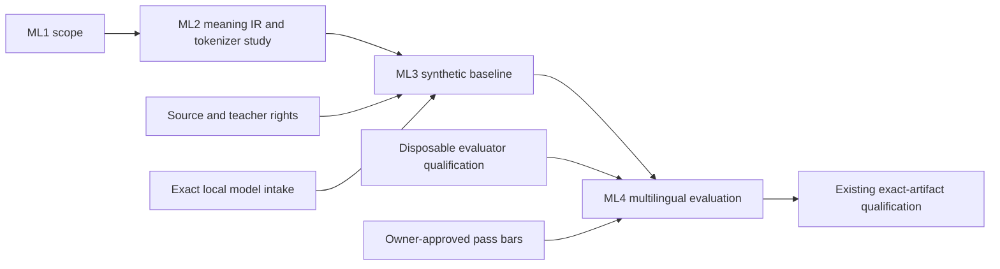

# Guru-Code multilingual coding roadmap

**Status:** design and synthetic-prototype plan; no multilingual model capability is claimed.

## Product direction

The goal is to let a person describe a programming task in a language they
choose, then produce conventional code in a selected programming language and
verify it with the same executable tests. Sanskrit is a supported input
candidate and a source of grammatical ideas; it is not a required foundation
for every language. No programming language's syntax or identifiers are
replaced by Sanskrit in this first experiment.

### First experiment scope

- Natural-language inputs: Hindi and Sanskrit, with a matched English control
  only where useful for comparison.
- Generated code: conventional Python.
- Shared intermediate representation (IR): language-neutral task meaning,
  inputs and types, constraints, requested change, and acceptance conditions.
- User-visible explanation: the requester's chosen language when that output
  has been evaluated; otherwise clearly labeled as an experiment limitation.
- Initial tasks: a small, rights-cleared and human-authored set of bounded
  Python tasks. No internet corpus is implied or admitted by this scope.
- Evaluation: each language variant maps to the same task ID and hidden test
  suite. Keep translations/paraphrases of one task in one leakage group.

This is a planning scope, not a claim that Hindi or Sanskrit input parsing,
translation, code generation, or explanation works today. The selected
Qwen2.5-Coder-1.5B + LoRA candidate keeps its pinned base tokenizer. Do not
train a new tokenizer, expand its vocabulary, download the model, or start
training under this plan. A tokenizer change would define a distinct student
candidate and require new rights, artifact, compatibility, and qualification
records.

## Four added work units

These units extend the existing Guru-Code gates; they do not replace teacher
and data rights, isolated evaluator qualification, corpus admission, exact
student intake, approved compute, training, or exact-artifact qualification.

| ID | Work unit | Deliverable and exit condition | Status |
| --- | --- | --- | --- |
| ML1 | Freeze interaction scope | Versioned task contract for Hindi and Sanskrit input to Python output; explicitly distinguish script, natural language, programming language, and explanation. Owner confirms languages, task families, supported scripts, and out-of-scope behavior. | **Experiment scope set:** Hindi and Sanskrit input, conventional Python output, Devanagari for the first pair. Broader native-language coverage and numeric success bars remain open. |
| ML2 | Define meaning representation and tokenizer study | Strict, versioned IR with typed inputs, constraints, requested operation, and acceptance conditions; synthetic paired examples; tokenizer coverage report for the exact selected tokenizer if and when its artifacts are locally approved. Each pair must preserve the same task meaning. | **IR schema and one synthetic paired fixture implemented.** Four focused tests and the full Guru suite passed. The paired wording has not had independent Sanskrit review. No natural-language parser or tokenizer coverage is implemented; the selected tokenizer is not locally qualified or inspected. |
| ML3 | Build a synthetic multilingual baseline | Create only temporary, authored examples for a narrow task set; compare direct-language prompting with IR-mediated prompting under the same model, code, and tests. Save no transformed corpus and use no external provider. | Blocked on an approved local model/runtime for execution; design can proceed. |
| ML4 | Qualify multilingual evaluation | Freeze task groups and target-free tests; report exact code-test pass rates and failure categories by input language, script, task family, and prompt route. Require a reviewed threshold and non-regression rule before looking at hidden results. | Blocked on disposable evaluator qualification and owner-approved pass bars. |

## Rights and storage constraints

The current I7 decisions remain binding:

- Local qualified evaluator only.
- No external transmission of prompts, code, traces, or candidate data.
- Transformed data is ephemeral only. Do not persist a multilingual training
  corpus, tokenizer output, or SFT export under this policy.
- Checkpoints stay private and local; no weight distribution.
- Teacher/output rights do not grant source-data rights. Review each source,
  translation, annotation, and generated example for its exact permitted use.

Official language documentation may be a useful reference collection, but it
is not automatically training data. Each source needs a pinned revision,
license and use review, attribution/removal handling, and an explicit decision
for training, evaluation, transformation, and retention. Community Q&A or
issue discussions are excluded unless a source-specific review permits the
intended use. The current ephemeral-retention rule prevents building a
persistent transformed training corpus even if source permission exists.

## Architecture boundary

Keep three layers independently testable:

1. **Language understanding:** Hindi or Sanskrit instruction becomes a
   structured task intent. This layer must preserve ambiguity and ask for
   clarification when essential details are missing.
2. **Code task:** the shared IR is checked for types, constraints, and
   acceptance conditions without requiring English prose.
3. **Code execution and review:** conventional Python output is tested by the
   qualified local evaluator and then presented through Maataa's existing
   human-review flow.

The existing Guru tokenizer contains a normalization/segmentation experiment,
but persistent tokenizer training is blocked by I7. Do not treat that module's
comments or language names as evidence of multilingual capability. Qwen + LoRA
also keeps the base tokenizer fixed; cross-lingual input quality must first be
measured with that exact tokenizer and base model. A new tokenizer requires a
separately selected and qualified student path.

## Dependency order and completion count

All four added units are required for a multilingual-input claim. ML1 and the
IR design in ML2 can be completed locally without a model. The synthetic
fixture design can proceed without rights-bearing data, but model execution
in ML3 waits for an approved exact local model. ML4 waits for the isolated
evaluator and frozen pass bars. The existing release gates still apply after
these units; completing this multilingual delta alone does not qualify a
checkpoint or make Guru-Code release-ready.

**Verification:** `python -m pytest tests/test_multilingual_intent.py -q`:
**4 passed**. Full Guru suite with `OMP_NUM_THREADS=1`:
**477 passed, 1 skipped**. `git diff --check` is clean. These tests cover the
IR's structure and fail-closed validation only; they do not measure translation,
language understanding, code quality, or executable correctness.

**Count:** four new mandatory multilingual work units. The current coding
roadmap remains in force; no existing mandatory gate is deleted. The optional
multi-agent trajectory comparison remains separate and is not a prerequisite
for this first multilingual input experiment.
